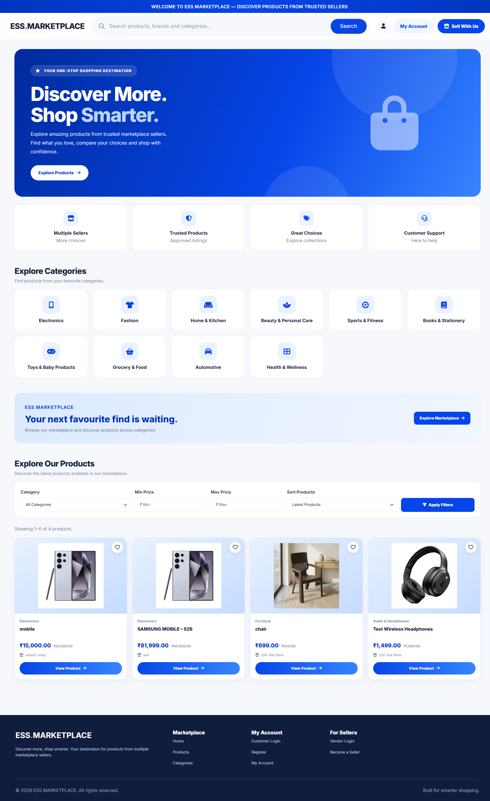
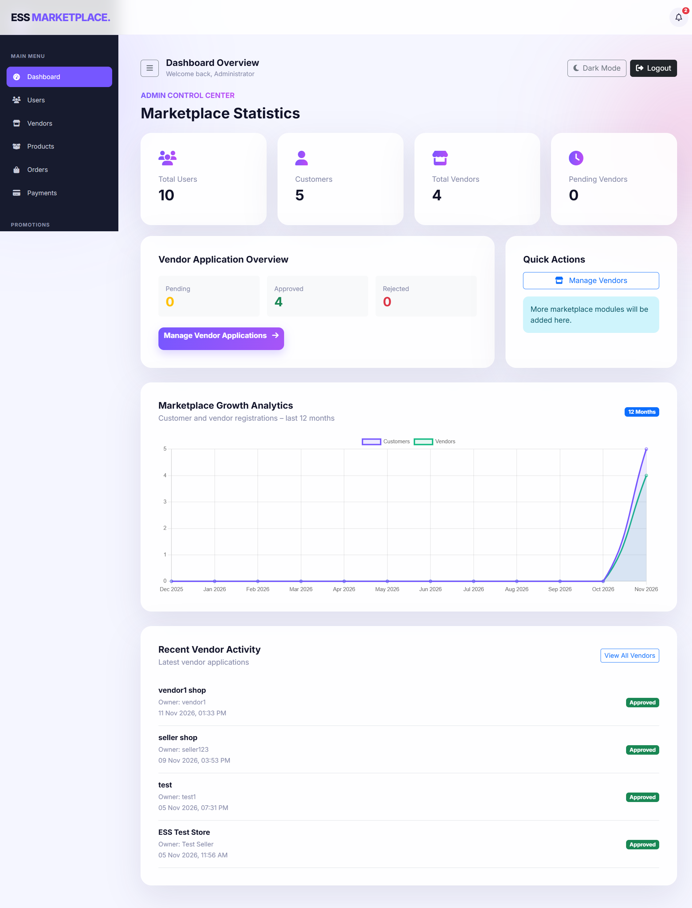
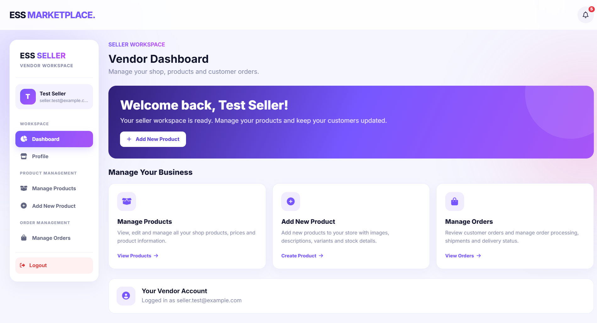
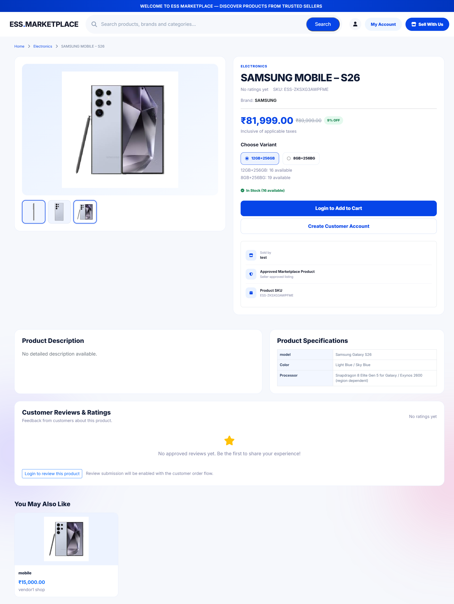

# ESS MARKETPLACE
### Multi-Vendor E-Commerce Marketplace

A full-stack multi-vendor e-commerce platform built using **Laravel 12, PHP 8.2 and MySQL**.

ESS MARKETPLACE enables multiple vendors to manage their shops and products while customers can discover products, manage shopping carts, apply promotional offers and place orders through an integrated checkout system.

---

## Project Overview

ESS MARKETPLACE is designed with three separate user roles:

- **Admin:** Manages users, vendors, products, orders, payments and promotions.
- **Vendor:** Manages shop profiles, products, product variants, inventory and orders.
- **Customer:** Browses products, manages wishlist and cart, applies coupons and places orders.

## Screenshots

> Project screenshots will be added in the `docs/screenshots/` directory.

### Customer Storefront


### Admin Dashboard


### Vendor Dashboard


### Product Details


### Shopping Cart and Checkout


### Order Management


---

## Technology Stack

| Category | Technologies |
|---|---|
| Backend | PHP 8.2, Laravel 12 |
| Database | MySQL / MariaDB |
| Frontend | HTML5, CSS3, Bootstrap 5, Tailwind CSS |
| JavaScript | JavaScript, jQuery, AJAX |
| Payment Gateway | Razorpay |
| Real-time Notifications | Laravel Reverb |
| Asset Build | Vite, npm |
| Version Control | Git, GitHub |

## Key Features

### Admin Module
- Admin authentication and dashboard
- User management and account status control
- Vendor application approval and management
- Product approval and management
- Order and payment management
- Coupon and promotional offer management

### Vendor Module
- Vendor registration and approval workflow
- Shop profile management
- Product creation, editing and deletion
- Product images, variants and specifications
- Inventory management
- Vendor order management

### Customer Module
- Customer registration and authentication
- Product browsing and product details
- Shopping cart and wishlist
- Coupon and promotional offer application
- Buy One Get One promotional offer
- Checkout and Razorpay payment integration
- Order history and order tracking
- Customer notifications

### Additional Functionality
- Role-based access control
- Permission-based authorization
- Vendor approval middleware
- Stock reservation and order processing
- Discount calculation and usage tracking
- Database and broadcast notifications

## Installation and Setup

### Prerequisites
- PHP 8.2 or compatible version
- Composer
- MySQL or MariaDB
- Node.js and npm
- Git

### 1. Clone the Repository

```bash
git clone https://github.com/sureshchenchala707-ai/marketplace.git
cd marketplace
```

### 2. Install PHP Dependencies

```bash
composer install
```

### 3. Configure Environment

```bash
copy .env.example .env
php artisan key:generate
```

Update the database configuration in `.env`:

```env
DB_CONNECTION=mysql
DB_HOST=127.0.0.1
DB_PORT=3306
DB_DATABASE=marketplace
DB_USERNAME=root
DB_PASSWORD=
```

Create the database before running migrations.

### 4. Run Database Migrations

```bash
php artisan migrate
```

Run the project's seeders after configuring any required administrator credentials.

### 5. Install Frontend Dependencies

```bash
npm install
npm run build
```

### 6. Configure Storage

```bash
php artisan storage:link
```

### 7. Configure External Services

Configure your own Razorpay API credentials and Laravel Reverb settings in `.env` if you want to test payment processing and real-time broadcasting.

Never commit actual API keys, passwords or secrets.

### 8. Start the Laravel Server

```bash
php artisan serve
```

Open:

http://127.0.0.1:8000

## Security

- Environment credentials are excluded from version control.
- Role and permission checks protect restricted application areas.
- Vendor approval is required for vendor dashboard access.
- Payment verification is handled through the payment gateway workflow.

## Project Purpose

Developed as a portfolio project to demonstrate full-stack web application development, Laravel architecture, multi-vendor e-commerce workflows, database relationships, payment integration and responsive frontend development.

## Author

**Suresh Chenchala**

GitHub: https://github.com/sureshchenchala707-ai

---

*This project is developed for learning and portfolio demonstration purposes.*